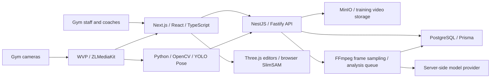

# Climbing AI

**English** | [简体中文](README.zh-CN.md)

A full-stack proof of concept for climbing-gym operations, AI-assisted route setting and athlete training. It combines a multi-tenant operations platform with computer vision, a 3D route editor and video-based training review.

[Live demo](https://yirocks.com/) · [Development source](https://github.com/webanaiservice/climbingAI) · [Implementation notes](#implementation-notes)

The demo requires sign-in. Some AI workspaces also require a server-side feature flag and an approved account. Repository implementation does not imply that every feature is enabled on the live deployment.

## Current scope

This repository incorporates development from `webanaiservice/climbingAI` through [`4c5351f`](https://github.com/webanaiservice/climbingAI/commit/4c5351fc05f47dc3e4bd337c9ead7b071a04cace), dated 16 October 2026. The synchronization was recorded on 12 November 2026 and retains the original commit history and contributors.

| Area                      | Implemented in the repository                                                                                               | Important boundary                                                                        |
| ------------------------- | --------------------------------------------------------------------------------------------------------------------------- | ----------------------------------------------------------------------------------------- |
| Gym operations            | Hold assets, stock movements, route versions, staff accounts, session authentication and tenant isolation                   | Single-gym POC validation; multi-gym commercial operations have not been established      |
| Camera observations       | Live streams, Python pose analysis, staged validation, video evidence and staff review                                      | Rule-based evidence scores are not calibrated accuracy probabilities                      |
| AI-assisted route setting | Cloud-assisted candidates, local constraint-solving fallback and manual editing                                             | Candidates remain drafts for human review and physical testing                            |
| Training boards           | Photo/GLB registration, manual route editing, starting-limb assignments, move sequences and saved route drafts              | Route drafts persist on the server; board calibration is stored separately in the browser |
| 3D wall editor            | Six wall segments, hold placement, cross-segment manual editing, geometry-aware candidate generation and JSON import/export | Geometry is reconstructed from design screenshots, not an as-built survey                 |
| Athlete training          | Profiles, measurements, sessions, attempts, video playback, AI review, coach feedback, tasks and progress reports           | AI observations are not a validated autonomous coach or medical assessment                |
| Tablet interaction        | Responsive workspaces, touch picking, focus/zoom controls and compatibility fallbacks                                       | Browser simulation does not replace testing on a physical iPad/Safari device              |

## Workspaces

### Operations center

- Manage hold specifications, photos, GLB assets, inventory balances and immutable stock movements.
- Create and version routes; configure visual holds with browser-side SlimSAM and publish definitions for the vision worker.
- Review camera observations with retained video evidence, keeping algorithm output separate from staff decisions.
- Use free-wall and virtual-board route-setting tools. The Tianyu ground-floor editor supports manual hold placement across wall segments; AI generation operates within one selected segment using its geometry.

### Training center

- Maintain athlete profiles, dated measurements, training sessions and attempts with an explicit timing source.
- Upload and replay training video, add timestamped markers and compare selected videos manually.
- Request model-selectable AI review from sampled frames and training context. Analysis is queued, reports are validated and request snapshots and failure states are retained.
- Keep coach feedback alongside the AI report. Generating a task from an AI report requires coach confirmation; manual tasks remain available without AI.
- Edit Tianyu board routes manually or adopt an AI candidate, preserving the original candidate baseline. Save independent server-side drafts with revision checks and organization isolation.

### Persistence

| Data                                                              | Storage                                                                |
| ----------------------------------------------------------------- | ---------------------------------------------------------------------- |
| Business records, training records and saved Tianyu route drafts  | PostgreSQL through Prisma                                              |
| Images, GLB assets, camera evidence and production training video | MinIO; optional local training-video storage for development           |
| Board calibration and virtual/free-wall editing state             | Browser storage; free-wall JSON export/import supports manual transfer |

A saved training-board route includes a board snapshot. Opening it does not replace the separately saved local board calibration. Draft routes are not automatically published into the operations route library.

## Architecture



The server derives the organization and permissions from the authenticated session. Model credentials remain server-side. AI review sends the selected video frames and relevant context to the configured provider after the in-product disclosure and consent step.

## Technology

| Layer          | Main technologies                                        |
| -------------- | -------------------------------------------------------- |
| Web            | Next.js 15, React 19, TypeScript, Three.js, model-viewer |
| API            | NestJS 11, Fastify 5, Zod, Swagger                       |
| Data and media | PostgreSQL 17, Prisma 6, MinIO, FFmpeg                   |
| Vision         | Python, OpenCV, Ultralytics YOLO Pose, PyTorch, SlimSAM  |
| Engineering    | pnpm, Turborepo, Vitest, ESLint, Prettier                |
| Deployment     | Azure Ubuntu VM, Docker Compose, Caddy, WVP/ZLMediaKit   |

## Local development

Use the versions declared in `package.json`: Node.js `>=22.23.1 <23` and pnpm `11.9.0`. Docker Compose is required for local data services. The vision worker also needs Python 3.11 or 3.12, FFmpeg and an accessible camera stream.

```bash
git clone https://github.com/flackothegoat/climbing-crm-poc.git
cd climbing-crm-poc
cp .env.example .env
corepack enable
pnpm install --frozen-lockfile
pnpm services:up
pnpm db:generate
pnpm db:migrate
pnpm dev
```

Configure the database, object storage and worker placeholders in `.env`. For cloud AI, configure `DEROUTER_API_KEY` and the provider base URLs on the API server. Do not expose them through `NEXT_PUBLIC_*`. Route-setting production access also depends on `AI_ROUTE_SETTING_ENABLED` and `AI_ROUTE_SETTING_ALLOWED_EMAILS`; see the deployment notes.

Without a model key, route setting can use the local constraint solver. Training profiles, logs, playback and manual tasks remain available, while cloud video analysis is unavailable.

| Entry                    | Local address                                            |
| ------------------------ | -------------------------------------------------------- |
| Web                      | <http://localhost:3100>                                  |
| API                      | <http://localhost:3101/api>                              |
| API documentation        | <http://localhost:3101/api/docs>                         |
| Operations route setting | <http://localhost:3100/dashboard/route-setting>          |
| Athlete training         | <http://localhost:3100/dashboard/training>               |
| Training-board routes    | <http://localhost:3100/dashboard/training/board-setting> |

The last three entries require sign-in. Redis is reserved in local Compose but is not required by the core workflow. Development and production Next.js builds use separate output directories.

### Optional vision worker

Configure the worker token, organization and camera source in the local environment, then run:

```bash
pnpm worker:setup
pnpm worker:probe
pnpm worker:start
pnpm worker:status
```

Local and Azure workers are separate processes. A local worker needs at least one published route definition in its local API. See the [worker guide](services/vision-worker/README.md) for lifecycle commands; no camera or production credentials are included here.

## Checks and deployment

```bash
pnpm lint
pnpm typecheck
pnpm test
pnpm worker:test
pnpm build
```

Database integration tests and database invariant checks require a separately configured test database. Historical acceptance records in `docs/` describe the environment and version tested; they are not a new full-system acceptance result for every checkout.

Azure deployment is manual. Synchronizing this GitHub repository does not deploy the live demo. Back up the database, apply the required Prisma migrations and validate the Web/API/media/worker services before releasing. The training module and persisted training-board routes introduce migrations that must be included when upgrading an older deployment.

## Implementation notes

- [Training center implementation and acceptance](docs/训练中心一期实现与验收.md)
- [Operations and training navigation](docs/业务结构与入口拆分-2026-09-27.md)
- [Manual training-board routes and tablet interaction](docs/天宇训练板手工定线-2026-10-15.md)
- [Ground-floor 3D wall editor](docs/天宇一楼三维定线-2026-10-16.md)
- [Photo-to-GLB registration](docs/天宇板照片与GLB配准-2026-09-26.md)
- [Registration tooling](tools/tianyu-registration/README.md)
- [Camera evidence and human review](docs/摄像头识别历史与人工复核设计.md)
- [Azure deployment](docs/Azure虚拟机部署说明.md)
- [Repository and CI policy](docs/Git仓库与CI策略.md)

The detailed implementation notes are currently in Chinese. They contain historical design and acceptance records; the source code and dated feature notes should be checked together when older documents describe a superseded state.

## Known limits

- This is a POC, without established commercial multi-gym SLAs, billing, disaster-recovery validation or compliance certification.
- AI routes need human review, installation checks and physical trials. Editing a candidate invalidates its original estimated score; the estimates are not calibrated route grades or safety guarantees.
- Camera analysis does not establish reliable multi-climber tracking, multi-camera 3D judgement or competition officiating. Camera or wall changes require recalibration.
- Training review samples the selected current video. Historical video comparison is manual; historical records provided as text do not mean the model has analyzed the older videos.
- The 3D wall uses inferred geometry and simplified holds. It is not a construction model or a contact-force/collision simulator.
- RFID hardware acceptance, full cross-gym asset circulation and automatic dynamic-IP allowlisting remain outside the validated mainline scope.
- Training workloads need further pagination, export, queue scaling and operational monitoring before larger-scale use.

## Development history

The original project is maintained at [flackothegoat/climbing-crm-poc](https://github.com/flackothegoat/climbing-crm-poc). Subsequent development from [webanaiservice/climbingAI](https://github.com/webanaiservice/climbingAI) has been incorporated with its original authorship and merge history intact. See the Git history for individual contributions.
