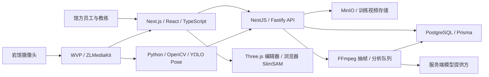

# Climbing AI 攀岩数字化平台

[English](README.md) | **简体中文**

面向攀岩馆运营、AI 辅助定线和运动员训练的全栈概念验证系统。平台将多租户业务、计算机视觉、三维定线编辑与训练视频复盘连接起来。

[在线演示](https://yirocks.com/) · [后续开发来源](https://github.com/webanaiservice/climbingAI) · [实现文档](#实现文档)

演示站需要登录。部分 AI 工作区还受服务端功能开关和账号白名单控制。仓库包含的功能不等于线上环境已经开启全部功能。

## 当前范围

本仓库已纳入 `webanaiservice/climbingAI` 截至 2026-10-16 的提交 [`4c5351f`](https://github.com/webanaiservice/climbingAI/commit/4c5351fc05f47dc3e4bd337c9ead7b071a04cace)。同步记录日期为 2026-11-12，原始提交历史和贡献者归属完整保留。

| 模块        | 仓库已实现                                                        | 使用边界                                        |
| ----------- | ----------------------------------------------------------------- | ----------------------------------------------- |
| 岩馆运营    | 岩点资产、库存流水、线路版本、员工账号、Session 与租户隔离        | 目前为单馆 POC 验证，尚未建立多馆商业运营能力   |
| 摄像头识别  | 实时流、Python 姿态分析、分层校验、视频证据和人工复核             | 规则证据评分不是校准后的正确概率                |
| AI 辅助定线 | 云端候选、本地约束求解后备和人工编辑                              | 候选仍需人工审核与现场试爬                      |
| 训练板      | 照片/GLB 配准、手工定线、起步四肢、动作序列和线路草稿             | 线路草稿存服务器，板面校准另存于浏览器          |
| 三维墙面    | 六段墙面、安装岩点、跨段人工编辑、按几何生成候选和 JSON 导入导出  | 几何由设计截图重建，不是竣工实测模型            |
| 运动员训练  | 档案、测量、训练课、攀爬、视频、AI 复盘、教练意见、任务和成长报告 | AI 观察不能视为经过专项验证的自动教练或医学评估 |
| 平板交互    | 响应式工作区、触摸选点、聚焦/缩放与兼容回退                       | 浏览器模拟不能代替实体 iPad/Safari 验收         |

## 业务工作区

### 运营中心

- 管理岩点规格、照片、GLB、库存余额与不可变流水。
- 建立和版本化线路，通过浏览器 SlimSAM 配置视觉岩点，发布给视觉 Worker。
- 查看摄像头识别记录与保留的录像证据，算法原判和员工复核分别保存。
- 使用自由墙、虚拟固定板定线工具。天宇一楼三维编辑器支持人工跨墙段安装；AI 按所选单墙段的实际几何生成候选。

### 训练中心

- 维护运动员档案、按日期记录的测量、训练课与攀爬尝试，明确计时来源。
- 上传和播放训练视频，添加时间点标记，人工选择视频进行对照。
- 选择模型，对抽样帧与训练上下文发起 AI 复盘；任务进入分析队列，报告校验后保留请求快照和失败状态。
- 教练意见与 AI 原稿并存。从 AI 报告生成训练任务前需教练确认；人工任务不依赖 AI。
- 手工编辑天宇板线路，或采用 AI 候选继续修改并保留原始基线。线路作为独立草稿存服务器，支持版本冲突检查与岩馆隔离。

### 数据保存

| 数据                                 | 保存位置                                       |
| ------------------------------------ | ---------------------------------------------- |
| 业务、训练记录、已保存的天宇线路草稿 | PostgreSQL / Prisma                            |
| 图片、GLB、摄像头证据、生产训练视频  | MinIO；开发可选本地训练视频存储                |
| 板面校准、虚拟固定板与自由墙编辑状态 | 浏览器本机；自由墙支持 JSON 手工导入导出换设备 |

已保存的训练板线路包含板面快照，打开线路不会覆盖另行保存的本机板面校准。线路草稿不会自动发布到运营线路库。

## 系统架构



服务端从已登录 Session 推导组织与权限，模型密钥仅留在服务端。AI 复盘在产品内展示处理范围并记录同意后，将选定视频的抽样帧与相关上下文发给配置的模型服务。

## 技术栈

| 层级       | 主要技术                                                 |
| ---------- | -------------------------------------------------------- |
| Web        | Next.js 15、React 19、TypeScript、Three.js、model-viewer |
| API        | NestJS 11、Fastify 5、Zod、Swagger                       |
| 数据与媒体 | PostgreSQL 17、Prisma 6、MinIO、FFmpeg                   |
| 视觉       | Python、OpenCV、Ultralytics YOLO Pose、PyTorch、SlimSAM  |
| 工程       | pnpm、Turborepo、Vitest、ESLint、Prettier                |
| 部署       | Azure Ubuntu VM、Docker Compose、Caddy、WVP/ZLMediaKit   |

## 本地开发

使用 `package.json` 声明的版本：Node.js `>=22.23.1 <23`、pnpm `11.9.0`。本地数据服务需要 Docker Compose；视觉 Worker 另需 Python 3.11 或 3.12、FFmpeg 和可访问的摄像头流。

```bash
git clone https://github.com/flackothegoat/climbing-crm-poc.git
cd climbing-crm-poc
cp .env.example .env
corepack enable
pnpm install --frozen-lockfile
pnpm services:up
pnpm db:generate
pnpm db:migrate
pnpm dev
```

在 `.env` 中设置数据库、对象存储和 Worker 占位值。云端 AI 的 `DEROUTER_API_KEY` 与模型服务地址只在 API 服务端配置，不能放入 `NEXT_PUBLIC_*`。生产定线还受 `AI_ROUTE_SETTING_ENABLED`、`AI_ROUTE_SETTING_ALLOWED_EMAILS` 控制，具体见部署文档。

未配置模型密钥时，定线可使用本地约束求解器。训练档案、日志、播放与人工任务仍可用，云端视频分析不可用。

| 入口       | 本地地址                                                 |
| ---------- | -------------------------------------------------------- |
| Web        | <http://localhost:3100>                                  |
| API        | <http://localhost:3101/api>                              |
| 接口文档   | <http://localhost:3101/api/docs>                         |
| 运营定线   | <http://localhost:3100/dashboard/route-setting>          |
| 运动员训练 | <http://localhost:3100/dashboard/training>               |
| 训练板定线 | <http://localhost:3100/dashboard/training/board-setting> |

后三个入口需要登录。本地 Compose 预留 Redis，但核心链路不依赖它。Next.js 开发与生产构建使用独立输出目录。

### 可选视觉 Worker

在本机环境设置 Worker token、组织与摄像头源后执行：

```bash
pnpm worker:setup
pnpm worker:probe
pnpm worker:start
pnpm worker:status
```

本机 Worker 与 Azure Worker 是独立进程。本机 API 至少要有一条已发布的线路视觉定义。进程管理详见 [Worker 说明](services/vision-worker/README.md)；本页不包含摄像头或生产凭据。

## 检查与部署

```bash
pnpm lint
pnpm typecheck
pnpm test
pnpm worker:test
pnpm build
```

数据库集成测试与不变量检查需要单独配置测试库。`docs/` 中的历史验收记录对应当时版本及环境，不等于每次检出都重新通过完整系统验收。

Azure 仍采用人工发布。同步 GitHub 仓库不会部署线上 demo。发布前需备份数据库、应用相应 Prisma migration，并验证 Web/API/媒体/Worker。训练模块和训练板线路服务端保存引入了迁移，升级旧部署时必须一并处理。

## 实现文档

- [训练中心一期实现与验收](docs/训练中心一期实现与验收.md)
- [训练中心与运营中心入口拆分](docs/业务结构与入口拆分-2026-09-27.md)
- [训练板手工定线与平板交互](docs/天宇训练板手工定线-2026-10-15.md)
- [一楼三维定线编辑器](docs/天宇一楼三维定线-2026-10-16.md)
- [照片与 GLB 配准](docs/天宇板照片与GLB配准-2026-09-26.md)
- [配准工具](tools/tianyu-registration/README.md)
- [识别历史与人工复核](docs/摄像头识别历史与人工复核设计.md)
- [Azure 部署](docs/Azure虚拟机部署说明.md)
- [Git 仓库与 CI 策略](docs/Git仓库与CI策略.md)

详细实现文档目前为中文，包含历史设计与验收记录；旧文档与当前状态不一致时，结合代码和有日期的功能说明核对。

## 已知边界

- 本项目是 POC，尚未建立商业多馆 SLA、计费、灾备验证与合规认证。
- AI 线路需要人工审核、安装检查和现场试爬；修改候选后原估算评分失效。估算不能视为校准后的等级或安全承诺。
- 摄像头分析尚未建立可靠的多人跟踪、多机位三维判定与赛事判罚；摄像头或墙面变化后需要重新校准。
- 训练复盘抽取当前选定视频；历史视频人工对照，历史文字记录不表示模型已经分析过历史视频。
- 三维墙体使用推断几何与简化岩点，不是施工模型或接触受力/碰撞模拟器。
- RFID 硬件验收、完整跨馆资产流转及动态公网 IP 自动白名单仍不属于已验收的主线范围。
- 大规模使用前还需补充分页、导出、分析队列扩展和运行监控。

## 开发来源

原始项目位于 [flackothegoat/climbing-crm-poc](https://github.com/flackothegoat/climbing-crm-poc)。本次纳入 [webanaiservice/climbingAI](https://github.com/webanaiservice/climbingAI) 的后续开发，保留原作者信息与合并历史。个人贡献以 Git 提交记录为准。
